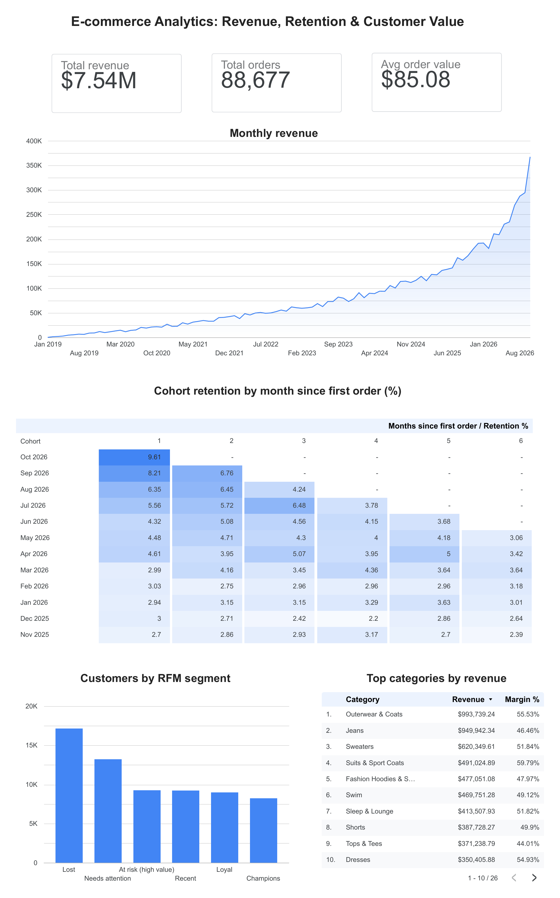
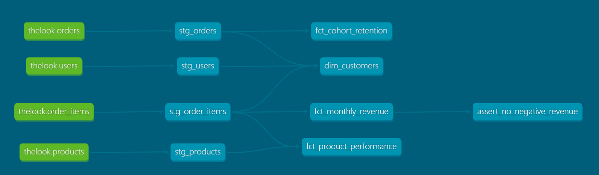

# E-commerce Analytics Warehouse (dbt + BigQuery)


An analytics engineering project that turns raw e-commerce tables into tested, documented data models in BigQuery, and answers four business questions in a Looker Studio dashboard.

**Stack:** SQL (BigQuery), dbt Core, dbt_utils, GitHub Actions (keyless auth with Workload Identity Federation), Looker Studio (now Data Studio)



**Live dashboard:** https://datastudio.google.com/reporting/00a609b3-6286-4146-8c73-360bb38a0c50 

## Business question

An online fashion store is growing fast. Leadership wants to know:

1. Is revenue growth coming from more orders or from bigger baskets?
2. Do new customers come back after their first purchase?
3. Which customers carry the revenue, and which valuable ones are slipping away?
4. Which product categories drive revenue, and at what margin?

## Dataset

BigQuery public dataset `bigquery-public-data.thelook_ecommerce`, a synthetic fashion store created by Google (orders, order items, users, products). The data is fictional, so the findings show the method, not a real company's results.

Analysis window: January 2019 to October 2026. November 2026 is excluded from trend views because the month is still in progress.

## Architecture



| Layer | BigQuery dataset | Materialization | What it does |
|---|---|---|---|
| Source | `bigquery-public-data.thelook_ecommerce` | public tables | Raw orders, order items, users, products |
| Staging | `dbt_dev_staging` | views | Select needed columns, rename keys (`id` to `order_item_id`, `user_id`, `product_id`), one model per source table |
| Marts | `dbt_dev_marts` | tables | Business-ready models for analysis and the dashboard |

| Mart | Grain | Purpose |
|---|---|---|
| `fct_monthly_revenue` | month | Revenue, orders, customers, average order value, month-over-month growth |
| `fct_cohort_retention` | cohort month x months since first order | Share of each cohort that buys again |
| `dim_customers` | customer | Lifetime value, recency, RFM score and segment |
| `fct_product_performance` | product | Units, revenue, gross margin, revenue rank within category |

Staging models are views, so they cost no storage. Marts are tables, so the dashboard reads small pre-aggregated data instead of scanning raw tables.

## SQL techniques

- **CTEs** to build each model in readable steps (filter, aggregate, then calculate).
- **Window functions:** `LAG` for month-over-month growth, `NTILE(5)` for RFM quintiles, `RANK() OVER (PARTITION BY category)` for product ranking.
- **Cohort logic:** each customer's first order month defines the cohort, and `DATE_DIFF(..., MONTH)` gives months since first order.
- **SAFE_DIVIDE** so growth and margin ratios return null instead of failing when the denominator is zero.

Key decisions:

- Revenue excludes items with status `Cancelled` or `Returned`, so it reflects sales the store kept.
- The cohort heatmap starts at month 1. Month 0 is always 100% and would hide the differences between cohorts.
- Average order value in the dashboard is `SUM(revenue) / SUM(orders)`, not an average of monthly averages.

## Data quality

20 data tests run with every `dbt build`:

- `unique` and `not_null` on every primary key in staging and marts.
- `relationships` tests: every order points to an existing user, every order item points to an existing product.
- `dbt_utils.unique_combination_of_columns` on the cohort grain (`cohort_month`, `months_since_first_order`).
- A custom singular test, `assert_no_negative_revenue`, that fails if any month has negative revenue.

**CI:** every push to `main` runs `dbt build` in GitHub Actions against BigQuery. Authentication uses Workload Identity Federation, so no service account key exists anywhere. The Google Cloud organization policy blocks key creation, and federation only accepts tokens from this repository.

## Key findings

**1. Growth comes from order volume, not basket size.**
Total revenue is $7.54M from 88,677 orders (average order value $85.08). From May to October 2026, monthly revenue grew 59% ($230K to $367K) while orders grew 59% (2,728 to 4,335). Average order value stayed between $82.75 and $86.00. To keep growing, the store depends on acquiring and converting more buyers.

**2. Repeat purchase is the biggest gap, but newer cohorts are improving.**
Across all cohorts since 2019, only 1.94% of customers buy again in their first month after purchase, and 1.54% in month 12. Recent cohorts perform better: month 1 retention rose from 2.70% (November 2025 cohort) to 8.21% (September 2026 cohort).

**3. A quarter of customers bring half of the revenue, and half of that group is at risk.**
Champions (12.5% of customers) generate 26.0% of revenue. At risk (high value) customers (14.0%) generate another 25.4%. Together, 26.5% of customers account for 51.4% of revenue. Lost customers are the largest group (26.0%) but bring only 10.1%. A win-back campaign should target the 9,238 at-risk high-value customers first.

**4. The top 5 categories bring 44% of revenue across 26 categories, with different margins.**
Outerwear & Coats leads with $994K at a 55.5% gross margin. Jeans is a close second ($950K) but has the lowest margin in the top 5 (46.5%). Suits & Sport Coats has the highest margin in the top 5 (59.8%).

## Dashboard

One-page Looker Studio report built on the marts:

- Scorecards: total revenue, total orders, average order value
- Monthly revenue trend (2019 to October 2026)
- Cohort retention heatmap (last 12 cohorts, months 1 to 6)
- Customers by RFM segment
- Top categories by revenue and margin

BigQuery sandbox tables expire after 60 days, so the screenshot above is the permanent record. Run `dbt build` to recreate the tables and the live dashboard works again.

## How to run

```bash
python -m venv .venv && source .venv/bin/activate
pip install -r requirements.txt
cp profiles.yml.example ~/.dbt/profiles.yml   # set YOUR_GCP_PROJECT_ID
gcloud auth application-default login
dbt deps
dbt build              # builds 8 models and runs 20 tests
dbt docs generate      # lineage graph and model documentation
```

## Author

**Maria Camila Gonzalez Nuñez** · [LinkedIn](https://www.linkedin.com/in/marianunez-data)
